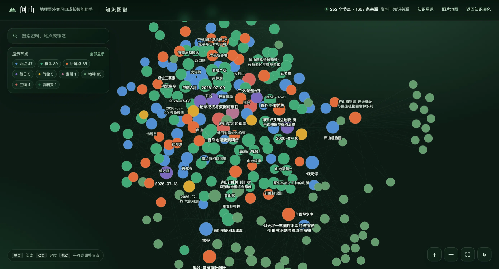
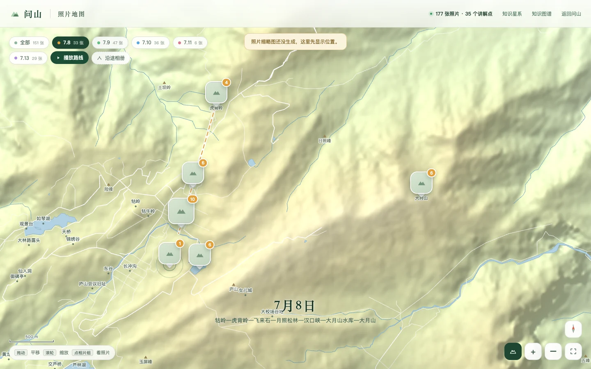
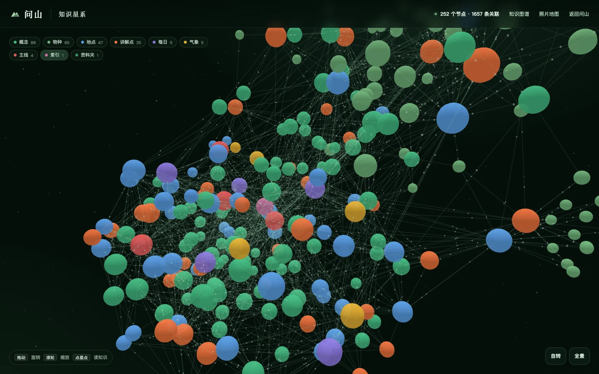
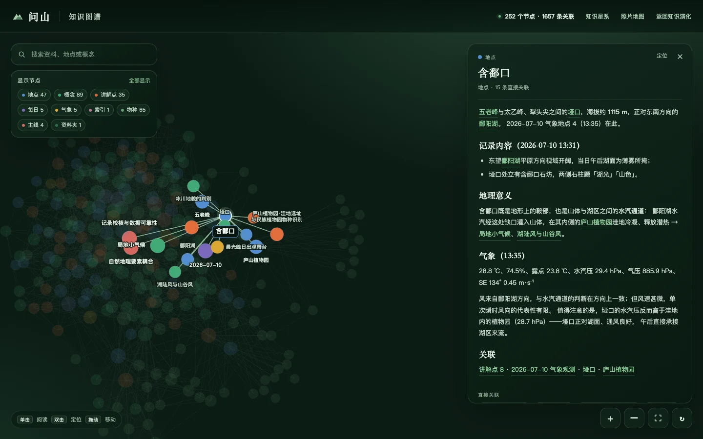
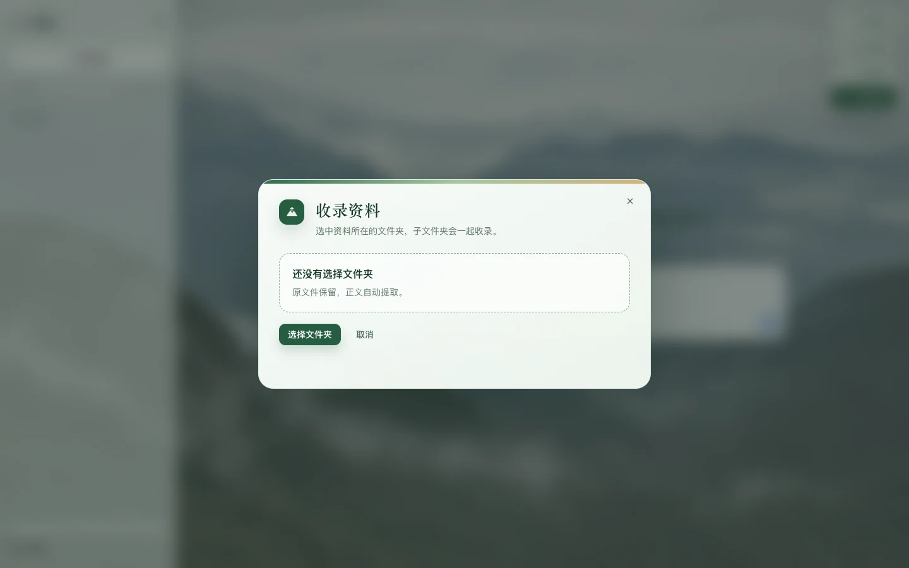

<p align="center">
  
</p>

<h1 align="center">问山 · Wenshan</h1>

<p align="center"><strong>地理野外实习的开源知识库</strong><br>
从历届实习资料建库，沿着路线查点位、读讲解、问问题。</p>

<p align="center">
  <a href="#快速开始">快速开始</a> ·
  <a href="#界面截图">界面截图</a> ·
  <a href="docs/product/user-guide.md">用户手册</a> ·
  <a href="docs/deploy.md">部署指南</a> ·
  <a href="https://github.com/xuedai-mayi/wenshan/issues">问题反馈</a>
</p>

<p align="center">
  <a href="https://github.com/xuedai-mayi/wenshan/actions/workflows/ci.yml"></a>
  <a href="LICENSE"></a>
</p>

<p align="center">
  
</p>

## 问山能做什么

- **整理实习资料**。导入讲义、照片、录音和 GIS 数据，模型生成带来源的知识草稿，由教师审核发布。
- **在现场查讲解**。按地名、概念和点位检索已发布的知识，回答附来源，资料未覆盖的问题可登记待补充。
- **回看路线和知识关系**。在地形底图上查看照片和逐日路线，或用二维图谱和三维星系浏览知识节点。

仓库内置庐山示例数据，安装后即可浏览图谱和路线。问答与自动生成草稿需要配置模型。

## 快速开始

准备 Node.js 22.19+（推荐 24）和 pnpm。导入 PDF、Word、录音或 GIS 数据时，建议安装 Python 3.11。

```bash
git clone https://github.com/xuedai-mayi/wenshan.git
cd wenshan
npm install -g pnpm@11.7.0
npm run setup
npm start
```

服务默认运行在 `http://127.0.0.1:3080/`。如果端口已被占用，以终端打印的地址为准。进入 **设置 → 模型** 可配置模型与 API Key。

容器或服务器安装见[部署指南](docs/deploy.md)。

## 界面截图

| 照片地图 · 回放庐山实习路线 | 知识星系 · 浏览三维知识关系 |
| --- | --- |
| [](docs/images/photo-map.webp) | [](docs/images/knowledge-galaxy.webp) |

| 知识图谱 · 查看含鄱口讲解 | 知识演化 · 收录实习资料 |
| --- | --- |
| [](docs/images/knowledge-detail.webp) | [](docs/images/source-intake.webp) |

## 文档与贡献

| 你想做什么 | 从这里开始 |
| --- | --- |
| 导入资料、审核发布、现场问答 | [用户手册](docs/product/user-guide.md) · [常见问题](docs/product/faq.md) |
| 自行部署、备份与恢复 | [部署指南](docs/deploy.md) · [隐私说明](PRIVACY.md) |
| 理解检索与知识构建 | [架构](docs/architecture.md) · [构建管线](docs/self-build-pipeline.md) · [GeoRAG 评测](docs/evaluation/eval_report.md) |
| 提交改动 | [贡献指南](CONTRIBUTING.md) · [版本记录](CHANGELOG.md) |

开发时可用 `npm test` 运行单元测试，安装运行时后用 `npm run test:integration` 验证产品链路。完整自检用 `npm run preflight`。

## 许可

问山以 [MIT 许可证](LICENSE) 发布。内置运行时与第三方组件保留各自的版权和许可声明，详见 [NOTICE](NOTICE.md)。
