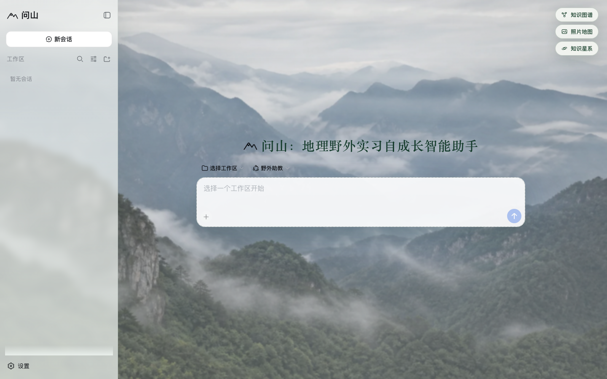

# 问山（Wenshan）

**把一次地理野外实习，变成一套会生长的知识库。**

[](LICENSE)
[](CHANGELOG.md)
[](https://nodejs.org/)
[](docs/deploy.md)

讲义、PDF、照片、录音、GIS 数据丢进去，问山自动抽出知识草稿；教师审核、口令发布后，学生即可现场提问、看点位讲解、在真实地形上翻照片。答不上来的问题会自动登记为知识缺口，成为下一轮补资料的依据。

仓库自带完整运行时和全部业务组件：安装脚本在本机构建运行时，克隆后即可启动一个可离线使用的独立智能体服务。



> 产品落地页：[docs/site/index.html](docs/site/index.html) · 用户手册：[docs/product/user-guide.md](docs/product/user-guide.md) · 部署指南：[docs/deploy.md](docs/deploy.md)

> 仓库已从 `dsh-wenshan` 更名为 `wenshan`。旧 clone 更新一下远端即可，数据目录与命令都不变：
> `git remote set-url origin https://github.com/xuedai-mayi/wenshan.git`。

---

## 目录

- [为什么是问山](#为什么是问山)
- [核心机制](#核心机制)
- [功能](#功能)
- [交付与运维](#交付与运维)
- [运行环境](#运行环境)
- [快速开始](#快速开始)
- [使用流程](#使用流程)
- [数据结构](#数据结构)
- [项目结构](#项目结构)
- [开发与测试](#开发与测试)
- [文档地图](#文档地图)
- [技术说明](#技术说明)
- [许可与声明](#许可与声明)

## 为什么是问山

野外实习的知识生产有三个绕不开的问题：资料散落在网盘、相机和个人笔记里，下一届从零开始；讲解靠临场记忆，同一个点位不同讲法；学生的问题问完就散了，不会变成下一届的准备。

通用聊天框能答，但给不出来源、不理解点位与路线，也不敢让错的内容进课堂。问山把流程做成产品：**AI 起草，人做决定，知识可追溯，缺口能闭环。**

## 核心机制

```text
资料收录 → 自动抽取草稿 → 人工审核 → 口令发布 → 现场问答 → 缺口登记 → 补资料 → 销缺口
             ↑________________________ 自成长闭环 ________________________|
```

三条硬约束，写在代码里而不是提示词里：

1. **草稿不自动入库。** 发布必须在存储层收到完整口令 `确认发布 draft-xxxxxxxx`；「可以」「继续」不会触发。
2. **只读与写入物理隔离。** 野外助教模式只注册检索与登记缺口工具；知识演化模式才能收录、建草稿、发布。
3. **回答必须有来源。** 未覆盖时明确说「已发布资料中未覆盖」并登记缺口，而不是编一个答案。

抽取是生成式的：同一份 1582 字资料两次跑出来的节点数实测为 13 / 18。这不是缺陷，是「发布前必须人工核对」这条设计成立的理由。

## 功能

- **知识演化**：收录文字、PDF、Word、图片、录音和常见 GIS 文件，**上传后自动抽取知识草稿**（用「设置 > 模型」里当前选中的模型，凭据不额外配置），人工确认后再发布。
- **野外助教**：只读正式知识库，支持概念检索、邻接关系、位置、气象和行程查询。
- **知识缺口闭环**：野外助教答不上来的问题自动登记为缺口待办，知识演化模式按被问次数补资料、发布后逐条销掉。
- **照片地图**：实习照片按讲解点聚簇落在真实地形晕渲底图上，支持逐日路线动画与「回放全程」时空演绎。
- **知识星系**：知识图谱的三维星系视图，节点按类型发光、关联线粒子流动，可旋转、聚焦并阅读节点正文。
- **可交互图谱**：搜索、筛选、拖动和定位节点，按需读取笔记正文。
- **本地持久化**：原始资料、提取结果、草稿、发布记录、缺口记录分开保存，重启后可恢复；事实源是 append-only 事件日志。
- **权限隔离**：野外助教没有资料写入和知识发布工具，只能登记缺口。
- **可运维**：一键备份/恢复、健康探针、容器镜像、systemd 单元、每日备份 timer。


检索质量有实测：152 题消融评测，完整配置 **Hit@1 91.4% / Hit@5 96.1%**，比纯词法 Hit@1 高 3.9 个百分点。报告见 [docs/evaluation/eval_report.md](docs/evaluation/eval_report.md)，`npm run eval` 可复现。

## 交付与运维

| 形态 | 命令 / 文件 | 适用 |
| --- | --- | --- |
| 本机 | `npm start` | 一位教师、一台笔记本 |
| 内网服务 | [`deploy/wenshan.service`](deploy/wenshan.service) + [`deploy/Caddyfile`](deploy/Caddyfile) | 实习队 15—60 人现场共用 |
| 容器 | [`Dockerfile`](Dockerfile) + [`docker-compose.yml`](docker-compose.yml) | 已有 Docker 运维体系 |
| 每日备份 | [`deploy/wenshan-backup.timer`](deploy/wenshan-backup.timer) | 长期运行的服务器 |

运维命令：

| 命令 | 作用 |
| --- | --- |
| `wenshan backup [目录] [--data-only]` | 备份知识库与运行状态（自描述归档 + SHA-256；`--data-only` 不含凭据） |
| `wenshan restore <归档> [--dry-run]` | 恢复；先给现状留副本，白名单外的路径整体拒绝 |
| `wenshan health [--url URL] [--json]` | 探活 `GET /wenshan/api/health` |
| `wenshan doctor` | 环境体检 |
| `wenshan preflight` | 发布前自检：体检 + 测试 + 挂载层校验 |

公网部署必须走反向代理做 TLS 与登录，并给应用加 `--trusted-host <域名>`；完整清单见 [docs/deploy.md](docs/deploy.md#安全清单上线前逐条打勾)。

## 运行环境

- Node.js 22.19 及以上（推荐 24）
- pnpm（只在安装阶段用，`npm install -g pnpm`）
- Python 3.11（可选，用于 PDF / Word / 录音 / GIS 提取与数据重建；纯文本问答与图谱页面不需要）

Windows、macOS、Linux 走同一条路径：只有一个入口 `wenshan`（`bin/wenshan.mjs`，通过 `package.json` 的 `bin` 暴露）。没有平台专用脚本，也不需要双击批处理——Windows 上同样在 PowerShell / cmd 里敲 `npm start` 或 `wenshan`。

几个由启动器自动处理、通常不用管的事：

| 机制 | 行为 |
| --- | --- |
| Python 探测 | `python3.11` → `py -3.11` → `python3` → `python`，可用 `WENSHAN_PYTHON=python3.12` 钉住 |
| Python 依赖 | 装在项目内 `.venv`，不碰系统环境（macOS 的 PEP 668 会挡住全局 pip） |
| 依赖分组 | `requirements/` 下的 `core`（必需）+ `audio` / `gis` / `tools`（缺轮子只降级对应格式） |
| 运行状态 | 写在项目内 `.wenshan-home`，不读写系统里其它服务的状态目录（可用 `WENSHAN_HOME` 改） |
| 界面语言 | 首次启动写入中文偏好；「设置 > 通用 > 语言」可切英文，`WENSHAN_LOCALE=en` 改默认值 |
| 端口 | 默认 `3080`，被其它服务占用时自动顺延并打印实际地址 |

## 快速开始

```bash
git clone https://github.com/xuedai-mayi/wenshan.git
cd <仓库目录>
npm start         # 首次运行会先问「现在安装？」，回车即可；也可先跑 npm run setup
```

想把它当成一个常驻命令（在任何目录直接调用）：

```bash
npm link          # 把 bin 链接进全局 prefix
cd ~/任意目录
wenshan           # 起 web 服务，并在就绪后自动打开浏览器
```

启动后终端会打印可用地址（默认 `3080`，被占用时自动顺延）：

- 主界面：`http://127.0.0.1:3080/`
- 知识图谱：`http://127.0.0.1:3080/wenshan/knowledge-graph`
- 照片地图：`http://127.0.0.1:3080/wenshan/photo-map`
- 知识星系：`http://127.0.0.1:3080/wenshan/knowledge-galaxy`

常用命令：

| 命令 | 作用 |
| --- | --- |
| `wenshan` / `wenshan start` | 启动 web 服务并在就绪后打开浏览器；缺依赖时引导安装 |
| `npm start` | 同上（仓库内的等价写法，首次运行会先询问是否安装） |
| `npm run setup` | 安装 / 修复依赖（幂等，`--force` 重跑） |
| `npm run doctor` | 环境体检：Node、pnpm、Python、运行时、页面依赖、数据、端口、挂载层 |
| `npm run health` | 探活运行中的服务 |
| `npm run backup` / `npm run restore` | 备份 / 恢复知识库与运行状态 |
| `npm run data` | 从原始资料重建 `data/*.json` |
| `npm run terrain` | 生成地形晕渲底图 |
| `npm run eval` | 152 题检索消融评测 |
| `npm test` | 测试（运行时未构建时自动跳过集成测试） |
| `npm run preflight` | 发布前自检：体检 + 测试 + 挂载层校验 |

`npm run <命令>` 与 `wenshan <命令>` 完全等价（npm script 只是 `node bin/wenshan.mjs` 的别名），全局链接后不再需要 `npm run` 前缀。

启动参数透传给运行时自己的参数解析：

```bash
npm start -- --port 3081                      # 换端口
npm start -- --host 127.0.0.1 --port 0        # 让系统分配端口
npm start -- --dry-run                        # 只打印渲染后的挂载层与启动命令
wenshan start -- --trusted-host wenshan.example.com   # 域名反代时放行 authority
```

依赖装了哪几组、缺哪几组，`npm run doctor` 会逐项列出；缺录音 / GIS 时该格式的上传只会降级，不影响文本与文档。

照片地图的地形晕渲底图由 `npm run terrain` 生成（从 AWS 开放高程瓦片下载 DEM，一次生成后离线可用；缺失时页面自动退回纯矢量底图）。

首次进入主界面后，在 `设置 > 模型` 中配置模型和 API Key。凭据写入本机配置，不进入本仓库。

## 使用流程

### 收录资料

切换到 `知识演化`，选择一个资料文件夹，或直接粘贴短文本。系统按 SHA-256 内容指纹去重，原件和提取结果会分别保存。

资料落库后立即在后台自动构建草稿：正文按小节切块（默认 2500 字/块，超 60 块等距抽样），逐块调用「设置 > 模型」里选中的模型抽取七类节点（讲解点 / 地点 / 概念 / 物种 / 气象 / 每日 / 主线），合并去重、与已有图谱对账后落成待审核草稿。基础图谱里已有的同名同类节点不会重复新建，而是单独列为"待补充"。

构建是后台任务，上传接口先返回，不阻塞页面。进度和失败原因在 `GET /wenshan/api/evolution/build` 里；要重跑某份资料：`POST /wenshan/api/evolution/build {"sourceIds":["src-…"],"force":true}`。模型没配 Key 时会在状态里直接提示去「设置 > 模型」补上。

支持的主要格式：

| 类型 | 格式 |
| --- | --- |
| 文字 | TXT、Markdown、CSV、TSV |
| 文档 | PDF、DOCX |
| 图片 | JPG、PNG、WebP、HEIC、TIFF |
| 录音 | MP3、WAV、M4A、OGG、FLAC、AAC |
| GIS | GeoJSON、GPX、包含 Shapefile 或 GDB 的 ZIP |

### 审核并发布

发送 `处理最新资料` 后，知识演化引擎会读取来源并生成草稿。草稿不会自动进入正式知识库。确认内容无误后，按页面提示发送完整口令：

```text
确认发布 draft-xxxxxxxx
```

`可以`、`继续` 等普通回复不会触发发布。发布成功后，检索引擎会立即更新。

### 现场问答

切换到 `野外助教` 即可使用正式知识库。这个模式只注册读取工具，不能修改来源、草稿或已发布知识。

### 知识缺口闭环

野外助教确认"已发布实习资料中未覆盖此问题"后，会把问题原话登记为知识缺口；同一问题重复被问只累计次数。待补清单出现在知识图谱页左侧"待补充问题"面板，也可以在 `知识演化` 对话中发送 `查看知识缺口` 查看。补充资料并发布后，让知识演化引擎逐条销掉对应缺口。

## 数据结构

基础庐山数据位于 `data/*.json`。运行期间新增的资料和知识写入 `data/knowledge/`：

```text
data/knowledge/
├─ events.jsonl
├─ sources/
├─ extracted/
└─ structured/
```

`data/knowledge/`、`data/photos/`、`.venv/`、`.wenshan-home/`、`backups/` 和本机凭据都已经加入 `.gitignore`。运行状态（会话、凭据、profile 层）落在 `.wenshan-home/`，删掉即重置。公开仓库前仍应检查原始实习记录、照片和地理数据的授权与隐私边界。

如需从原始 GDB、Obsidian 知识库和每日整理目录重建基础数据，先修改 `config/lushan.json` 中的三个来源路径，再运行：

```bash
npm run data                                   # 默认 config/lushan.json
npm run data -- config/other-site.json         # 换一个实习区
```

## 项目结构

```text
bin/wenshan.mjs          统一命令行入口（start / setup / doctor / data / terrain / eval / test /
                         preflight / backup / restore / health）
agents/                  两种 agent 模式
  field-qa/              野外助教（只读问答）
  knowledge-build/       知识演化（写入审核）
config/                  站点配置与产品挂载配置
  lushan.json            庐山站点配置（数据源路径、图层映射、文案）
  wenshan.yml            产品挂载层
packages/
  georag/                GeoRAG 检索、空间查询、知识事件存储
  agent/                 工具注册与两种模式的系统提示词
  intake/                资料收录、HTTP 接口与图谱/地图/星系页面
scripts/                 安装、启动、数据构建、评测、运维与发布检查脚本
  lib/ops.mjs            备份 / 恢复 / 健康探测
requirements/            Python 依赖分组（core / audio / gis / tools）
data/                    可公开的基础检索数据
deploy/                  systemd、Caddy、容器入口与备份 timer
docs/                    架构、产品文档、部署指南、评测报告与截图
  site/                  产品落地页
tests/                   存储、冒烟、产品链路、运维层与浏览器验收测试
runtime/                 随仓库分发的运行时源码（第三方快照）
```

## 开发与测试

```bash
npm test                  # 存储 + CLI + 运维层 + 构建（零外部依赖）
npm run test:integration  # 冒烟 + 产品链路（需要先构建运行时）
npm run eval              # 152 题检索消融评测，写 docs/evaluation/
npm run preflight         # 跨平台发布自检：体检 + 测试 + 挂载层校验
```

发布流程：push 到 `main` 由 [`.github/workflows/ci.yml`](.github/workflows/ci.yml) 跑单元与全链路；打 `v*` tag 由 [`release.yml`](.github/workflows/release.yml) 校验版本、构建镜像并冒烟健康接口、产出源码包与 SHA-256 并建 Release。改动约定见 [CONTRIBUTING.md](CONTRIBUTING.md)。

## 文档地图

| 想知道什么 | 看哪里 |
| --- | --- |
| 产品定位、用户、指标、路线图 | [docs/product/PRD.md](docs/product/PRD.md) |
| 教师/学生怎么操作 | [docs/product/user-guide.md](docs/product/user-guide.md) |
| 常见问题 | [docs/product/faq.md](docs/product/faq.md) |
| 界面文案规范（叫法、按钮、报错、空态） | [docs/product/ux-copy.md](docs/product/ux-copy.md) |
| 装到服务器 / 公网 / 容器 | [docs/deploy.md](docs/deploy.md) |
| 分层与数据流 | [docs/architecture.md](docs/architecture.md) |
| 上传即构建管线 | [docs/self-build-pipeline.md](docs/self-build-pipeline.md) |
| 检索评测 | [docs/evaluation/eval_report.md](docs/evaluation/eval_report.md) |
| 安全与隐私 | [SECURITY.md](SECURITY.md) · [PRIVACY.md](PRIVACY.md) |
| 版本变更 | [CHANGELOG.md](CHANGELOG.md) |
| 支持与联系 | [SUPPORT.md](SUPPORT.md) |

## 技术说明

问山自带运行时：会话、模型调用、工具执行、Web 界面与业务组件在安装后共同组成一个本机独立服务。图谱使用 `force-graph`，基础检索结合中文二元组 BM25、知识关系扩展和空间距离衰减。主服务只监听 `127.0.0.1`，适合本机演示和教学环境。

如需部署到公网，应另外配置登录鉴权、HTTPS、限流、文件安全检查和数据备份，不能直接暴露本机服务端口。仓库已提供 [Caddy 配置](deploy/Caddyfile) 与 [部署指南](docs/deploy.md) 覆盖这些项。

## 许可与声明

本项目使用 [MIT License](LICENSE)。随仓库分发的运行时源码及其第三方依赖同样以 MIT 许可分发，原始版权声明、许可文本和第三方依赖声明保留在随包源码目录内，汇总信息见 [NOTICE.md](NOTICE.md)。`force-graph` 使用 MIT 许可证。

山谷背景由本项目生成，仓库不包含原 Wallpaper Engine 素材包。公开使用庐山示例数据之前，请自行确认数据授权和隐私边界。
